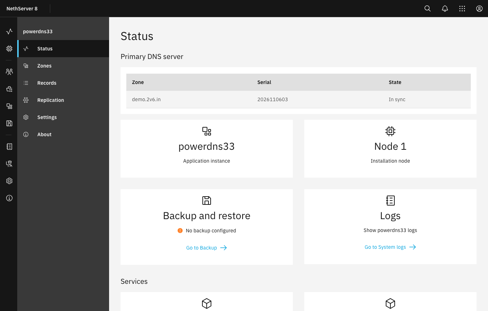
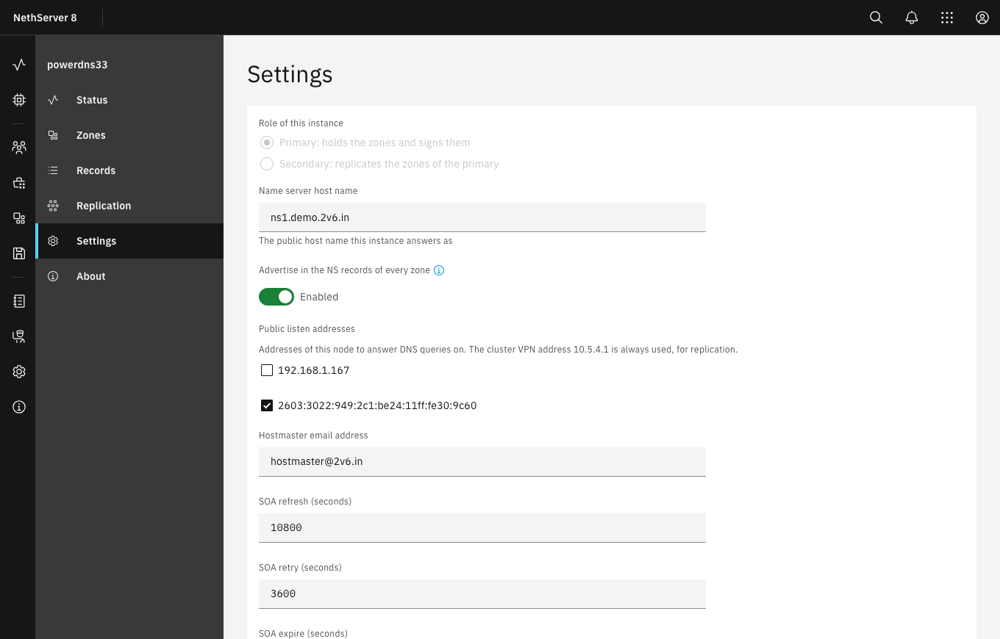
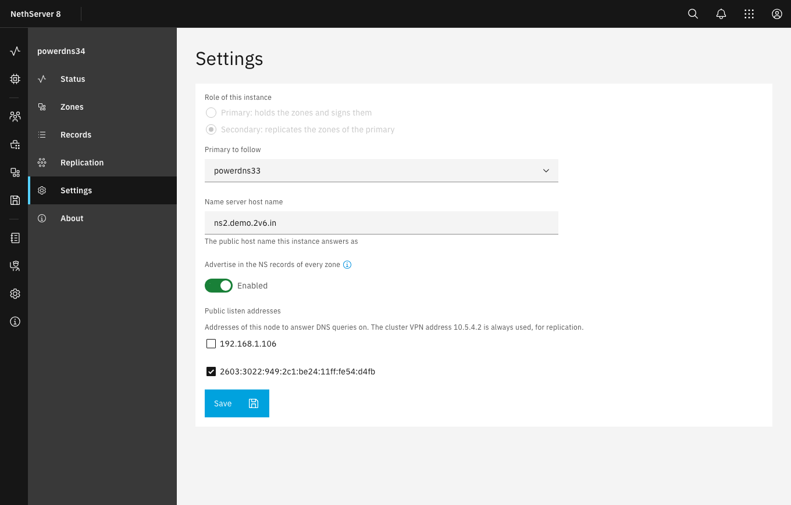
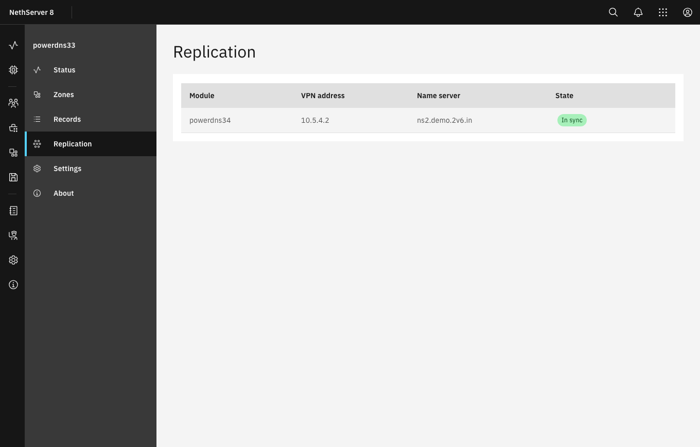
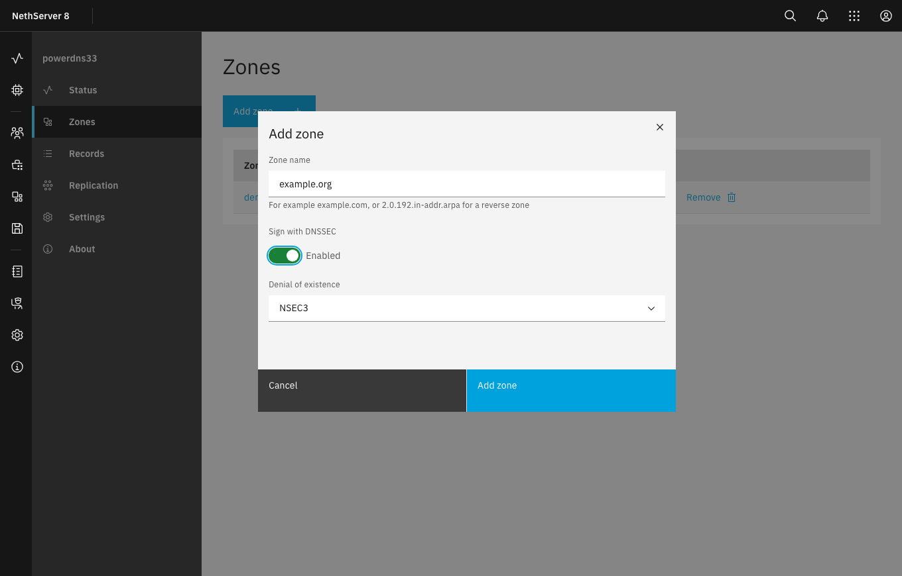
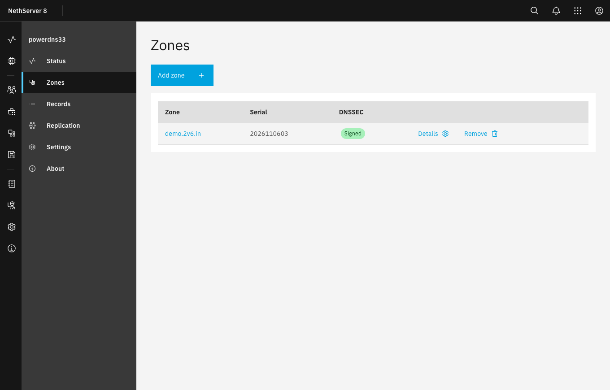
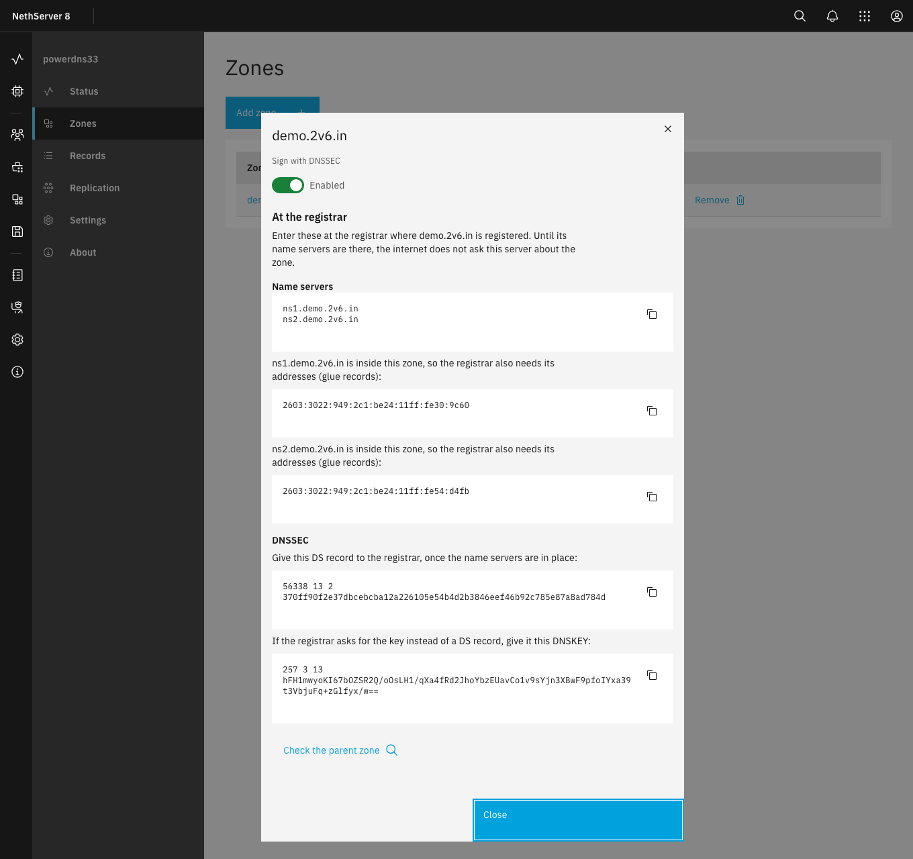
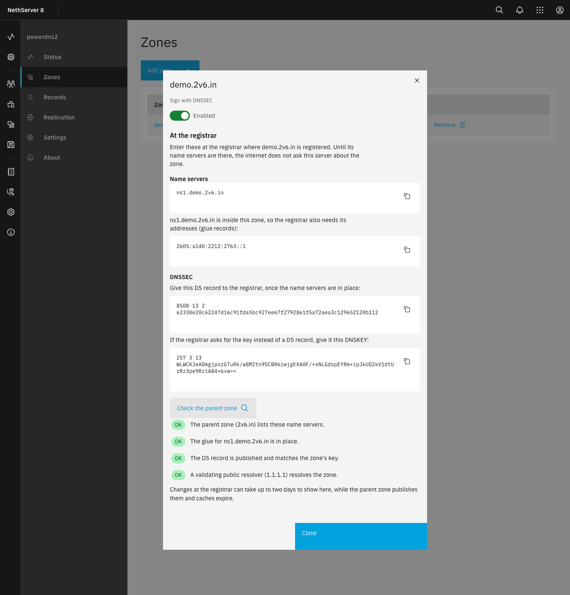
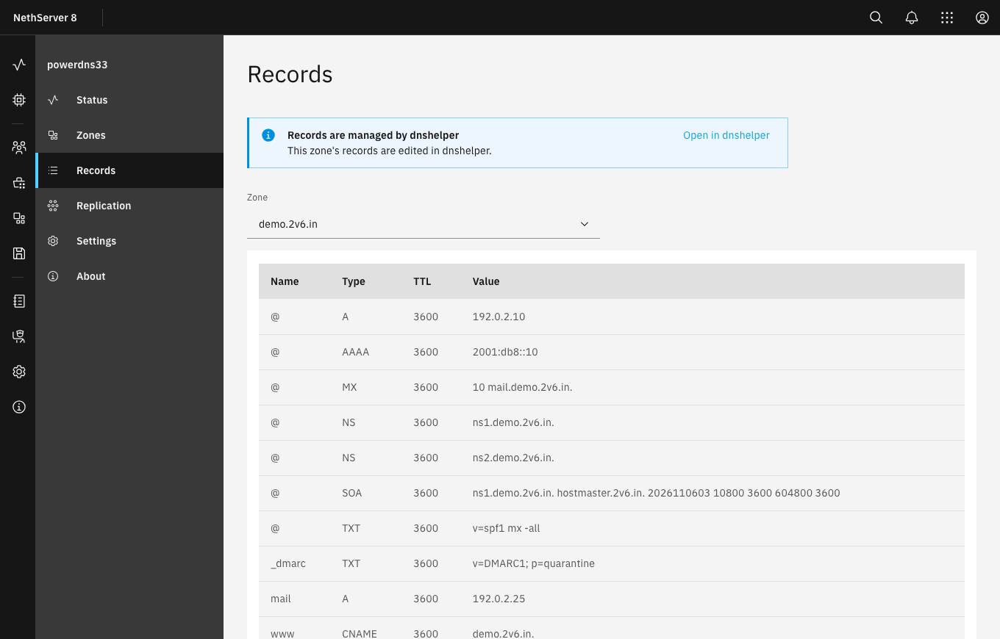

# powerdns user guide

This guide is for the person who administers an NS8 cluster. It explains what powerdns does, how
to set up the primary and its secondaries, how to add zones, and what to enter at your registrar so
that the internet uses your servers. Developers and people who prefer the command line should also
read the [main README](../README.md).

- [What powerdns does](#what-powerdns-does)
- [Before you start](#before-you-start)
- [Setting up the primary](#setting-up-the-primary)
- [Adding secondaries](#adding-secondaries)
- [External secondaries](#external-secondaries)
- [Adding a zone](#adding-a-zone)
- [At the registrar](#at-the-registrar)
- [Checking the delegation](#checking-the-delegation)
- [Records, and dnshelper](#records-and-dnshelper)
- [Turning DNSSEC off, and removing a zone](#turning-dnssec-off-and-removing-a-zone)
- [Backup, restore and moving the primary](#backup-restore-and-moving-the-primary)
- [When something goes wrong](#when-something-goes-wrong)

## What powerdns does

powerdns makes your cluster the **authoritative** DNS server for your own domains: the server the
rest of the internet asks for the addresses of `www.example.com` or the mail servers of
`example.com`. It can sign your zones with DNSSEC, and it copies them to more servers on other nodes
of your cluster, so that your domains keep answering when one node is down.

It is not a resolver. It answers only for the zones you add, and refuses everything else, so it
cannot be misused as an open resolver. Name resolution for your LAN stays with dnsmasq or the Samba
DC.

Each instance has one of two roles, chosen when you first configure it:

- the **primary**: there is one per cluster. It holds the zones, signs them, and is where you
  change them;
- a **secondary**: any number, at most one per node. It copies every zone of the primary and
  answers for them too. Changes reach it within seconds.

The pages of the application, in the side menu:

| Page | What it is for |
|---|---|
| **Status** | The instance's role, each zone's serial, the secondaries' state, warnings such as standby, and the last backup |
| **Zones** | The zones, their DNSSEC state, and what to enter at the registrar for each |
| **Records** | Look at the records of a zone, and change them when dnshelper does not manage it |
| **Replication** | On the primary: the secondaries and whether they are in sync |
| **Settings** | The role, the name server name, the addresses to answer on, and the SOA settings |
| **About** | Version and links |



## Before you start

You need:

- **A domain at a registrar that lets you set its name servers.** Most do, under a name such as
  *Nameservers*, *DNS servers* or *Delegation*. If the domain uses names inside itself for its name
  servers, such as `ns1.example.com` for `example.com`, the registrar must also let you enter their
  addresses. These are called *glue records*, *child name servers*, *host records* or *registered
  name servers*, depending on the registrar. For DNSSEC, the registrar must accept a DS record (or
  a DNSKEY).
- **A public address on each node that answers DNS**, reachable on port 53 over both UDP and TCP.
  powerdns opens the port in the node's firewall. If the node is behind a router that does NAT,
  forward UDP and TCP port 53 on the router to the node as well.
- **Port 53 free on those addresses.** The Samba DC, dnsmasq, Pi-hole and AdGuard Home may already
  hold it. The Settings page shows which addresses are in use.
- **A host name for each server**, such as `ns1.example.com` and `ns2.example.com`. Each name must
  have an A or AAAA record with the server's public address, wherever that name's own zone is
  hosted: here, or at another DNS host.
- **At least two nodes, in different places**: one for the primary and at least one for a
  secondary. See [How many servers, and where](#how-many-servers-and-where).

### How many servers, and where

Every zone must be served by **at least two name servers**. The DNS specification requires it
([RFC 1034](https://www.rfc-editor.org/rfc/rfc1034#section-4.1), section 4.1), and most registries
refuse a domain with fewer.

The two must not fail together. [RFC 2182](https://www.rfc-editor.org/rfc/rfc2182) (BCP 16,
*Selection and Operation of Secondary DNS Servers*) says that servers "must be placed at both
topologically and geographically dispersed locations", so that a single power cut, link failure
or provider outage cannot take all of them offline (section 3.1). Two nodes in the same building,
or behind the same internet connection, count as one place: when that connection is down, so is
your domain, and mail to it bounces once the sending servers give up retrying.

So place at least one secondary somewhere else: at another site, or on a VPS at a different
provider. An NS8 cluster can span the internet, because its nodes talk over the cluster VPN, so a
remote node can simply join it.

RFC 2182 goes further and recommends **three servers** for most domains, with at least one well
away from the others (section 5): with only two, a domain runs on one whenever the other is down
for maintenance. For a reverse zone, fewer servers, less spread out, are usually enough.

## Setting up the primary

Install powerdns from the Software center on the node that will hold the primary, then open
**Settings**. If the Software center does not list powerdns, add its software repository first, as
the [README](../README.md#install) explains:

| Field | What to enter |
|---|---|
| **Role of this instance** | *Primary*. The role cannot be changed later: to change it, remove the instance and install it again |
| **Name server host name** | The public name of this server, such as `ns1.example.com` |
| **Advertise in the NS records of every zone** | On, normally. Turn it off for a *hidden primary*: one that is not listed as a name server, so that only the secondaries answer the internet |
| **Public listen addresses** | The node addresses to answer DNS on. Leave addresses in use by another service unticked. The cluster VPN address is always used, for replication |
| **Hostmaster email address** | The contact address published in every zone's SOA record |
| **SOA refresh, retry, expire, minimum** | The defaults suit most zones. *Minimum* is also how long resolvers remember that a name does not exist |

Choose **Save**. The instance starts answering at once.



## Adding secondaries

Install powerdns on another node, open its **Settings**, and choose *Secondary*. The primary is
already selected under **Primary to follow**. Give the secondary its own **Name server host name**,
such as `ns2.example.com`, and its listen addresses, then save. Put at least one secondary on a
node at another site or provider (see [How many servers, and
where](#how-many-servers-and-where)).



The secondary registers with the primary and receives a key of its own, used for nothing but
copying the zones over the cluster VPN. Every zone, existing or new, reaches it by itself. The
**Replication** page on the primary lists the secondaries, and shows each one as *In sync*, a number
of zones behind, or *Unreachable*.



Adding or removing an advertised secondary changes the name servers of **every** zone. Update the
name servers at the registrar of each of your domains afterwards (see [At the
registrar](#at-the-registrar)).

If a secondary is gone for good, for example because its node failed, its entry stays on the
Replication page as *Unreachable*, with a **Remove** button. A secondary that still answers cannot be
removed there: remove its module in the Software center instead, and it unregisters itself.

## External secondaries

A secondary does not have to be in your cluster. A provider's secondary DNS service, or a BIND,
Knot, NSD or PowerDNS server run by a friend or another office, can serve some or all of your
zones too. It is a cheap way to have a server at another provider without running a node there.

On the primary, open **Replication** and choose **Add external secondary**:

| Field | What to enter |
|---|---|
| **Name** | A label for the list, such as the provider's name |
| **NOTIFY addresses** | The addresses the provider tells you to send NOTIFY to, one per line. They are often not the addresses of its name servers |
| **Name servers** | The provider's name servers, such as `ns1.provider.example`, one per line |
| **Advertise these name servers** | On, normally, so that they go into the NS records of the zones the provider receives. Off for a server that is not to answer publicly |
| **Zones** | *All zones*, which includes zones you add later, or only the zones you tick |
| **Transfer authentication** | *TSIG key*, unless the provider cannot use one |

With a TSIG key you can let the module generate one, or paste the key the provider issued: its name,
algorithm and secret. After saving, the key is shown with a copy button, and in the form of a BIND
`key` statement. Enter it at the provider. **Show key** shows it again later, and **Edit** can
replace it, which revokes the old key at once.

At the provider, give this server as the primary (often called *master*) of each zone. Use the
node's public address, or the address of your router if the node is behind NAT: that is where the
NOTIFY messages come from, and where the provider transfers the zones from. Port 53 is already open
on the node.

The Replication page shows each external secondary as *In sync*, a number of zones behind, or *Not
answering*, by asking its NOTIFY addresses for each zone. Some providers' NOTIFY addresses do not
answer queries, so *Not answering* does not always mean something is wrong. An external secondary
can always be removed; its name servers then leave the NS records of its zones, and its key, or the
addresses it was allowed to transfer from, stop working at once. The copy of the zones it already
holds stays at the provider: delete the zones there too.

Some providers let you use name servers under your own domain, such as `ns3.example.com`. Such a
name inside the zone needs glue records at the registrar, with the addresses the provider gives you
for it: the zone's **Details** says so, and the delegation check confirms that the registrar
publishes glue for it, without checking the addresses.

As for internal secondaries, adding or removing an advertised external secondary changes the name
servers of the zones it receives: update them at the registrar (see [At the
registrar](#at-the-registrar)).

### Before you add one

- **The provider sees everything in the zones you give it**: every record, including names you
  never published anywhere, and every query for them, with the address of the resolver that asked.
  Give a provider only the zones you are comfortable with it holding, and check where it keeps query
  logs and for how long.
- **Transfers cross the internet unencrypted.** TSIG proves that a transfer comes from the right
  server and has not been altered, but anyone on the path can read it. Internal secondaries do not
  have this problem: their transfers travel inside the cluster VPN. PowerDNS does not offer
  encrypted zone transfers.
- **Sign your zones with DNSSEC.** A secondary can answer whatever it likes for the zones it holds.
  With DNSSEC, validating resolvers reject anything that is not what you signed.
- **Address-only transfers** are for providers that cannot use TSIG. Anyone who can send from the
  addresses you enter can read the zones given to that provider. Each entry can be no wider than a
  /24 for IPv4 or a /48 for IPv6.
- **The key is a secret.** Anyone who has it can read the zones given to that secondary. It is part
  of the primary's backup.
- After a restore or a move of the primary to another node, its public address may change. Update it
  at the provider, which transfers from the address it was given and may accept NOTIFY only from
  there.

## Adding a zone

On the primary, open **Zones** and choose **Add zone**:

- **Zone name**: the domain, such as `example.com`. A reverse zone works the same way, such as
  `2.0.192.in-addr.arpa`.
- **Sign with DNSSEC**: signs the zone. You can also turn it on later, and doing it later is the safer
  order for a domain that is already live elsewhere (see [Moving a live
  domain](#moving-a-live-domain-from-another-dns-host)).
- **Denial of existence**: *NSEC3*, the default, or *NSEC*. With NSEC, anyone can list every name in
  the zone; NSEC3 makes that much harder. Keep NSEC3 unless you have a reason not to.



The zone starts with its SOA record and one NS record for each advertised server. Its **Details**
open straight away, showing what the registrar needs.



## At the registrar

Until the registrar lists your servers as the domain's name servers, the internet does not ask
them anything: the zone exists here, but nobody looks for it. On **Zones**, choose **Details** for
the zone. **At the registrar** lists everything to enter there:



| What | When | Where it goes at the registrar |
|---|---|---|
| **Name servers** | Always | The domain's name server list. Enter every name shown, and remove the names of any former DNS host |
| **Glue records**: the addresses of a name server | Only when a name server's name is inside the zone itself, such as `ns1.example.com` for `example.com` | *Glue records*, *child name servers* or *host records*: the name, and its IPv4 and IPv6 addresses |
| **DS record** | Only when the zone is signed | *DNSSEC* or *DS records* |

Some notes on each:

- **Name servers.** The list is the same for every zone: the primary, unless it is hidden, and every
  advertised secondary. If a name lies in another zone you host here, that zone needs its A or AAAA
  record. If it lies in a zone at another DNS host, add the record there.
- **Glue records.** Details lists the public addresses from each server's Settings. An address that
  only works inside your network, such as `192.168.1.10`, is left out, because the internet cannot
  use it. When a node is behind NAT, Details may therefore list no address for it: give the
  registrar the public address that forwards port 53 to the node.
- **DS record.** It looks like `12345 13 2 9F86D0...`. Some registrars want it in one field; others
  ask for each part: the **key tag** (`12345`), the **algorithm** (`13`, ECDSA P-256 with SHA-256),
  the **digest type** (`2`, SHA-256) and the **digest** (the long hexadecimal string). A few
  registries, such as DENIC for `.de`, take the key itself instead: Details also shows the zone's
  **DNSKEY** for them. If the registrar asks for the key's flags, they are `257`.

For a **reverse zone**, there is no registrar. Ask whoever assigned you the addresses, usually your
ISP or your regional internet registry (RIPE, ARIN, APNIC, LACNIC or AFRINIC), to delegate the
zone to your name servers, and to add the DS record if the zone is signed.

### A new domain

For a domain that is not in use yet, the order does not matter much:

1. Add the zone, sign it if you want, and add its records.
2. Enter the name servers, and the glue records if Details shows any, at the registrar.
3. Enter the DS record, if the zone is signed.
4. Use [**Check the parent zone**](#checking-the-delegation) until every line is OK.

### Moving a live domain from another DNS host

For a domain that already works, at another DNS host, the order matters, or the domain stops
working for some of its visitors for a day or two:

1. **Add the zone here unsigned, and copy every record** from the old DNS host: dnshelper or the
   Records page can do it. Check the copy by asking this server directly, from a machine outside
   your network:

   ```
   dig +norec @<public address of this server> www.example.com A
   ```

2. **If the old DNS host signs the zone, remove its DS record at the registrar**, and wait for it to
   expire: often one day. Leave DNSSEC on at the old host in the meantime. If you skip this,
   validating resolvers reject the domain as soon as they reach your servers, because the old DS
   matches no key of yours.
3. **Change the name servers at the registrar** to the ones in Details, with the glue records if any.
4. **Keep the old DNS host running and unchanged** while the old name servers are still cached:
   often up to two days. Some visitors reach the old servers until then.
5. **Turn on DNSSEC here** (Details, **Sign with DNSSEC**), and enter the new DS record at the
   registrar.
6. Use **Check the parent zone** until every line is OK. The old DNS host can then go.

If the old DNS host does not sign the zone, skip step 2.

### When the name servers change

The name servers of every zone change when you change a server's **Name server host name**, turn
**Advertise** on or off, or add or remove an advertised secondary. Update the registrar of every
domain afterwards, and keep a removed server answering until the registrar's change has spread, if
you can.

## Checking the delegation

In a zone's Details, **Check the parent zone** asks the servers of the zone above yours (for
`example.com`, the servers of `com`) what they publish for it, and asks a public validating
resolver (Cloudflare's 1.1.1.1, or Quad9's 9.9.9.9 if it does not answer) whether the zone resolves.
It runs only when you choose it.



Each line is marked OK, Problem or Unknown:

| Line | What it means when it is a problem |
|---|---|
| Name servers | The parent does not delegate the zone yet, or lists different name servers. *Missing* are servers the registrar should list and does not; *Not served by this cluster* are names the registrar lists that are not yours, often a former DNS host |
| Glue | The parent publishes no address, or a different one, for a name server inside the zone |
| DS | A signed zone has no DS at the parent yet, or one that matches none of its keys. Or the zone is not signed but the parent still has a DS. The last two make the domain fail validation, so that resolvers which check DNSSEC refuse it |
| Resolution | The public resolver cannot resolve the zone. With everything else OK, this is most often a DS that does not match, or name servers that do not answer from the internet |

Changes at the registrar take time to appear here: the parent zone publishes them, often within
minutes but sometimes after hours, and the old answers stay in caches for up to two days.

The check uses only public DNS: your registrar's own page may already show a change that the parent
does not publish yet. For a closer look at DNSSEC, [DNSViz](https://dnsviz.net/) draws the whole
chain from the root to your zone.

## Records, and dnshelper

The **Records** page lists a zone's records. Choose the zone's name on the Zones page to open it.

When [dnshelper](https://github.com/danb35/ns8-dnshelper) 0.5.0 or later is installed, it adopts
every zone of the primary by itself, within seconds, and from then on records are changed there:
the Records page here becomes read-only, with a button that opens the zone in dnshelper. Other
modules, such as a mail server publishing its DKIM key, then change records through dnshelper too,
within the rules you set there.



Without dnshelper, records are changed on the Records page of the primary: **Add record**, or
**Edit** and **Delete** next to a record. Names are relative to the zone, with `@` for the zone itself.
The zone's own SOA and NS records are kept by powerdns and cannot be changed by hand.

A change reaches the secondaries within about ten seconds.

## Turning DNSSEC off, and removing a zone

Turning DNSSEC off deletes the zone's keys at once. **Remove the DS record at the registrar first**,
and wait for it to expire (often one day): until then, validating resolvers reject the domain.
Details asks for confirmation, and reminds you of this.

Removing a zone deletes it, its records and its keys, here and on every secondary in the cluster.
The same applies: if the zone is signed, remove the DS at the registrar first. If the domain should
keep working, point its name servers somewhere else before removing the zone. External secondaries
can no longer transfer it, but keep their copy, and may go on answering for it, until you delete it
at the provider.

## Backup, restore and moving the primary

The primary's backup holds its zones, records and DNSSEC keys, and its external secondaries with
their keys. A restore brings back the same keys, so the DS at the registrar stays valid, and
external secondaries keep working without a new key. A secondary's backup holds only its settings:
after a restore, it copies the zones from the primary again.

A restored or cloned primary waits in **standby** while the original still exists: it answers for
the zones but takes no changes. It takes over within a minute of the original being removed, which
is also how moving the primary to another node works. Secondaries and dnshelper follow it by
themselves.

If the new node has different public addresses, update the **Public listen addresses** in Settings,
then the glue records at the registrar of every domain that has them. Check each zone with **Check
the parent zone** afterwards. Give the new address to the provider of each external secondary
too: it transfers from the address it was given, and may only accept NOTIFY from there.

Because the backup holds the DNSSEC private keys and the external secondaries' keys, treat your
backup destination as sensitive. NS8 encrypts backups.

## When something goes wrong

These are the messages you may see, with what to check.

| Message | What it means and what to do |
|---|---|
| This cluster already has a primary | Only one primary per cluster. Configure this instance as a secondary of it |
| The role cannot be changed | Remove the instance and install it again with the other role |
| Port 53 is in use on an address | Another service answers DNS there. Choose another address, or stop that service on this address |
| The primary refused the registration | The secondary could not register. Check that the primary is running and reachable over the cluster VPN, then save the secondary's settings again |
| Only a primary can do this | Zones and records are changed on the primary. A secondary shows them read-only |
| This instance is in standby | A restored or cloned primary, waiting for the original to be removed. See [Backup, restore and moving the primary](#backup-restore-and-moving-the-primary) |
| dnshelper manages the records of a zone | Change them in dnshelper: **Open in dnshelper** on the Records page goes there |
| The zone's own NS and SOA records are set by this module | They follow the settings: change the name server names or the SOA settings instead |
| PowerDNS refused this record | The value is not valid for its type, for example a CNAME next to other records of the same name |
| A secondary still answers | It cannot be removed from the Replication page. Remove its module in the Software center |

A few more things that look like problems and are not:

- **A new zone shows *Waiting for the first transfer* on a secondary.** A new zone reaches the
  secondaries within about a minute.
- **The serial of a zone is a date followed by two digits.** That is the usual convention; it rises
  with each change. It also jumps to the current week's date each Thursday, when the signatures are
  renewed, so that the secondaries copy the zone again: a secondary that is a few minutes behind
  then is catching up.
- **An external secondary shows *Not answering*.** Some providers' NOTIFY addresses accept
  NOTIFY but do not answer queries. If the provider's name servers answer for the zone with the
  primary's serial, all is well.
- **An external secondary is behind for a while.** Providers check for changes on their own
  schedule, often within minutes of a NOTIFY but sometimes only at the zone's refresh interval.
- **Check the parent zone says the parent lists other name servers, a day after you changed them.**
  Some registries publish changes once a day, and some registrars send them in batches. Wait, then
  check again.

If something still does not work, the system log of the powerdns module (Logs in the NS8 admin
interface) shows what PowerDNS did. Please report bugs at
<https://github.com/danb35/ns8-powerdns/issues>.
